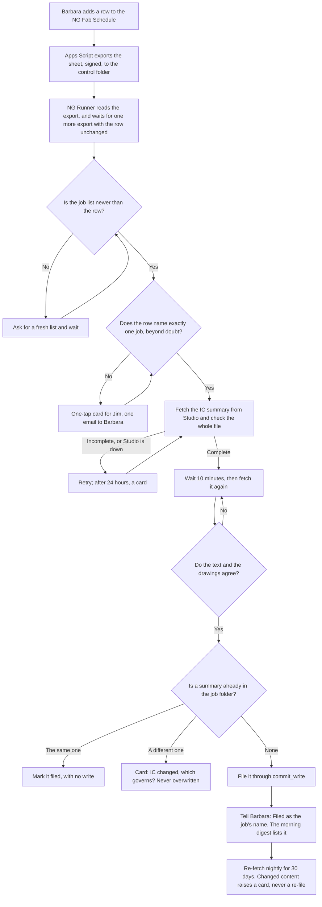
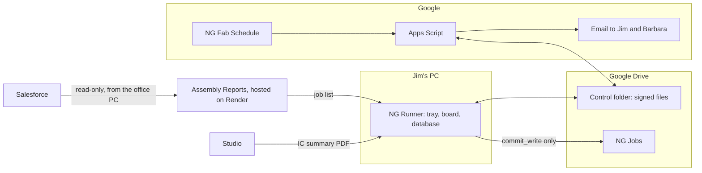
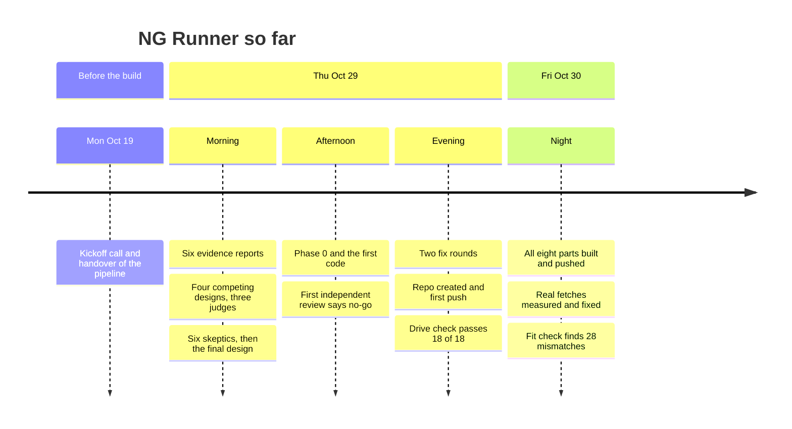

# NG Runner

NG Runner is a Windows tray app for the CNC office of Inspired Closets LA. When Barbara adds a job to the NG Fab Schedule, it finds the job in Salesforce, downloads its install report (the **IC summary**) from Studio twice, checks that the report is complete and belongs to that job, and files it in the job's folder, without anyone touching a file. Whenever it can't be sure of something, it asks Jim with a one-tap card. It never guesses.

That is Phase 1a, the first step of a staircase. Later phases add read-only guards, shared checking tools, a button for locking a job and, only if a test on past jobs passes, overnight building of walls and verticals.

Built and supported by Sulaiman Ahmed, for Jim Delany, owner of Inspired Closets LA.

> **Status, 2026-10-30, 4 AM Pacific.** Phase 1a's parts are built and tested, but they aren't wired into a running app yet, so NG Runner can't file a real job today. **Nothing is installed on Jim's PC.** Everything so far has been built and tested on Sulaiman's PC. See [Where it stands](#where-it-stands) and the [timeline](#timeline).

## Contents

- [Where it stands](#where-it-stands)
- [Why it exists](#why-it-exists)
- [What Phase 1a does](#what-phase-1a-does)
- [How it decides which job a row means](#how-it-decides-which-job-a-row-means)
- [What each person sees](#what-each-person-sees)
- [When things go wrong](#when-things-go-wrong)
- [The rules it never breaks](#the-rules-it-never-breaks)
- [How it is built](#how-it-is-built)
- [Timeline](#timeline)
- [Measured so far](#measured-so-far)
- [What comes next](#what-comes-next)
- [The later phases](#the-later-phases)
- [Working on the code](#working-on-the-code)
- [Repository map](#repository-map)
- [Client data and secrets](#client-data-and-secrets)

## Where it stands

| Stage | Share of the Phase 1a build | State |
|---|---|---|
| Foundations: safe writes, job matching, summary check | 20% | Built. The last fix round is under independent review |
| The eight separate parts | 30% | Built and on GitHub. A reconcile step is making them fit together |
| Wiring into a running app, and the day simulation | 30% | Not started |
| Independent verification and fixes | 12% | Not started |
| The installer build, the Apps Script guide and the test kit | 8% | Partly: the build and installer work; the kit doesn't exist yet |

**About 55% of the Phase 1a build is done.** That is a judgment from the parts finished and the hours left, not a measurement. Across all phases it is roughly 15 to 20%, a rougher guess, because the later phases aren't specified yet.

**In numbers, at commit [`439896a`](https://github.com/sulaiman013/NG-Runner/commit/439896a):** 13,621 lines of app code, 14,454 lines of tests, and 2,384 tests passing on a clean checkout.

**Not proven yet, and only provable on Jim's PC or on live Google:** the file-system checks on his Google Drive, the Apps Script running for real, a real tray icon and toasts, scheduled tasks under his account, and the auto-match rate on the real Fab Schedule.

## Why it exists

Jim turns each IC summary into a Mozaik CNC job through his own AI chat sessions and a toolkit of about 170 scripts. Today he, or someone in the office, has to get each summary by hand: download it from Studio through the Assembly Reports app, then upload it to the chat. On the 2026-10-19 kickoff call he also said the app "always saves in the downloads folder", and asked for a report to reach the job folder by itself when Barbara adds a job.

Measured from the NG Jobs files on 2026-10-29, before NG Runner ([docs/baseline.md](docs/baseline.md)): only **42 of 88 job folders (48%)** hold the summary under the standard name.

**Why a desktop app.** Only a program on Jim's own PC can see Mozaik's lock files, his Google Drive and his OneDrive. A hosted dashboard can't, and a Windows service can't see drives that belong to his user account. So it is a tray app that starts when he logs on, installed for his account, with no admin rights needed.

**What it won't do.** Software can't remove the expert work. The design's estimate is that Jim's roughly 103 minutes per job becomes about 93 after Phase 1a and 50 to 54 at the very best, after Phase 5. Phase 1a's value is that the hunting, downloading and uploading stop, and that nothing is filed under the wrong job.

## What Phase 1a does



**What lands in the job folder**, `NG Jobs\<Name_MMDDYY>\`, with a made-up job:

| File | For | Contents |
|---|---|---|
| `Testerson_101426_summary.pdf` | Everyone | The verified IC summary |
| `Testerson_101426_NGRunner.json` | Jim's chat sessions | What was filed, its checksum, any open cards. The chat reads this first |
| `Testerson_101426_NGRunner_log.txt` | People | One plain line per event, for example `10/30 3:05 PM  Filed the IC summary (landscape, 19 pages), checked on two fetches 10 minutes apart.` |

**Closet or garage.** A garage-only summary goes to `<Name>_Gar\`. Closets only, or closets and garage mixed, go to `<Name>\`: a mixed summary is one job, as Jim's own rules say. A card comes only when a design can't be classified, or when the row or the job's name says garage and no design does, and only that job waits.

**The summary check** is deliberately hard to pass. It reads the whole file: every checksum, the file's index and its ending, and whether each design on page 1 has its pages and drawings. A partial render that looks fine, or a file damaged by one bit, is refused. Two fetches must then agree on both text and drawings, because a render can be consistent with itself and still be early. Two byte-identical fetches don't count: real renders always differ in bytes, so identical ones mean something served one render twice.

**Add job.** The board has a button for a job that never gets a row. It enters the same pipeline, with the same checks.

## How it decides which job a row means

This is where a wrong job would come from, so the rule is strict: a row files only when **every word in it is explained** and only one job can possibly be meant. Otherwise it asks. A question costs Jim one tap; a wrong job costs a wrong cut.

Only Ready to Order and Ready to Install count as sold. Complete never counts, or every job installed before NG Runner would be a candidate. All names below are made up.

| Barbara types | The list holds | Result | Why |
|---|---|---|---|
| `Testerson_101426` | That exact Opportunity | Files | Exact name |
| `Testerson` | One sold job of that surname and designer | Files | Every word explained; no rival |
| `Testerson closet` | The same | Files | "closet" is a room word |
| `Testerson Master` | The same | Asks | "Master" can be a second surname, so it isn't a room word |
| `Testerson` | Two sold jobs of that surname | Asks | Several fit |
| `Testerson` | A sold job, plus a newer `Pat Testerson_101426` still at Propose | Asks | Salesforce can lag behind the sale |
| `Testerson remake` | A sold job | Asks | It may be a new run of the job |
| `Testerson` | Designer initials that fit two owners | Asks | Shared initials count for nobody |
| A cell over 200 characters | Anything | Asks | Never read, so it can't stall the app |

A card remembers the Studio ID behind each of its buttons, so an answer given days later, after a restart and a new job list, still means the same job. If that job is no longer on the list, the board says so and the row stays asked.

## What each person sees

| Who | What they get | What changes for them |
|---|---|---|
| **Barbara** | "Filed as `<Job>`" by email. One email listing the candidates when a row is unclear | Nothing to learn: she types rows as she does now, and corrects a name in her own cell |
| **Jim** | A board in his browser (Board, Your list, Cards, History, Health), a tray icon, the 6:30 AM digest by email, and a pop-up for the two kinds of card that make a job wait | Summaries appear by themselves. No new app or account |
| **Jim's chat sessions** | The filed summary and `<folder>_NGRunner.json` | They work from the filed copy instead of asking for an upload. The rule changes are drafted in [docs/p1a/rules-lines.md](docs/p1a/rules-lines.md) and [docs/p1a/skill-update.md](docs/p1a/skill-update.md), and need Jim's OK |
| **Sulaiman** | A daily "ran" line, developer items, watchdog alerts and a support bundle | [docs/p1a/runbook.md](docs/p1a/runbook.md) lists every alarm with its one-line fix, so a backup developer could take over |

**Tray colours:** green when all is well, amber with a count when something needs Jim, red when NG Runner itself is unwell, grey when paused. Each also has its own mark, so no two states differ by colour alone.

**Messages to Jim** follow his format: numbered, one line each, no intro or sign-off. A lint rejects anything else, and in particular any path, hash, Studio ID or error text.

## When things go wrong

| What happens | What NG Runner does |
|---|---|
| A row is unclear | Card for Jim, one email to Barbara. Only that row waits |
| The job list is older than the row | Asks for a fresh list, at most once per 5 minutes, and waits. An alarm if it stays stale for over an hour |
| Studio is down, or the address isn't found | Retries after 5, 15, 30 and 60 minutes, then hourly. A card after 24 hours |
| The render is early and incomplete | Retries every 30 minutes |
| Studio returns another job's report | Files nothing. If the job list shows that name is this job's new name, it is a rename, and NG Runner fetches under it. Otherwise a card and a developer item at once |
| A summary is already in the folder | The same: marked filed, no write. Different: a card. **Never overwritten** |
| A job's folder was there at install, or has moved to `NG Jobs\Old` | Writes nothing into it, never makes a second one, and the board says why |
| Someone replaced a filed summary by hand | Logged, never overwritten, and the notes are rewritten to describe the file that's there |
| The sheet suddenly loses or gains many rows | Holds that export until the next one says the same, so a half-loaded sheet starts nothing |
| NG Runner crashes or the PC restarts | Picks up where it stopped, with no duplicate file, message or card |
| The PC is off | The Apps Script watchdog notices the missing heartbeats and tells Sulaiman. Missed work is done at the next start, and named: "Missed the 6:30 AM digest: the PC was off. Sent at 8:12 AM" |
| Paused (tray, board or a signed file) | Files nothing. Heartbeats, the digest and messages go on |
| A new version fails to start twice | The launcher falls back to the previous version and tells Sulaiman |

**Silence is never success.** A dead PC, a missed message or an unverified value is shown as such. What can't be verified reads "could not verify".

## The rules it never breaks

The full list is in [AGENTS.md](AGENTS.md).

1. **One door for writes.** Everything written outside NG Runner's own data folder goes through `commit_write()`. It checks that the path is allowed, by file identity and not by name, that the file is still what NG Runner last wrote, and it backs up, writes to a temp file, renames and reads back. If any step fails, the whole commit rolls back.
2. **It deletes nothing it didn't just create,** and each removal is checked by identity first.
3. **It never writes while Mozaik could be using the files.** It waits; it never forces. Phase 1a writes nothing a Mozaik job reads, and this check joins the door in Phase 1b.
4. **Code decides.** No AI model takes part in any verdict, gate, message or parser. The only AI use planned is reading elevation drawings in Phase 5, and every value it reads must be confirmed by code from another source.
5. **Jim's rules come from his toolkit.** They are called or ported, never retyped. Where his documents disagree, it's raised as a question, never picked silently.
6. **It never guesses.**
7. **Salesforce is read-only, and NG Runner never talks to it directly.** It reads a list published by the Assembly Reports app, without emails or Salesforce IDs.
8. **No client data and no secrets in git.** See [below](#client-data-and-secrets).

## How it is built



**Stack:** Python 3.14, packaged with PyInstaller into a folder build of about 74 MB. SQLite for its record, Flask and waitress for the board on `127.0.0.1`, pystray for the tray, and pypdf for reading PDFs. Google Apps Script for everything on Google's side. Secrets sit in Windows Credential Manager.

### The parts

| Part | What it does | State |
|---|---|---|
| [`ngrunner/writes.py`](ngrunner/writes.py) | The one door for writes | Built, passed independent review |
| [`ngrunner/match.py`](ngrunner/match.py) | Matches rows, files and folders to jobs | Built, last review running |
| [`ngrunner/intake/summary_check.py`](ngrunner/intake/summary_check.py) | The strict whole-file check and the content fingerprint | Built, last review running |
| [`ngrunner/intake/fetch.py`](ngrunner/intake/fetch.py) | The Studio download and the two-fetch agreement | Built, tried on real jobs |
| [`ngrunner/intake/branch.py`](ngrunner/intake/branch.py) | Closet or garage | Built; its mixed-job rule is corrected in the wiring step |
| [`ngrunner/joblist.py`](ngrunner/joblist.py) | Reads the job list from Assembly Reports, and refuses a bad one whole | Built; the route it calls isn't deployed yet |
| [`ngrunner/fab.py`](ngrunner/fab.py), [`google/`](google/) | The Fab Schedule export, edit log, outbox, watchdog and prune | Built, tested under node, never run on live Google |
| [`ngrunner/store/`](ngrunner/store/) | The SQLite record, with migrations | Built |
| [`ngrunner/messages/`](ngrunner/messages/), `cards.py`, `digest.py`, `heartbeat.py` | Templates, the format lint, cards, the digest | Built |
| [`ngrunner/board/`](ngrunner/board/), `tray.py`, `toasts.py` | What Jim sees | Built; real tray and toasts untested |
| `launcher.py`, `single.py`, `selftest.py`, `backup.py`, `support.py` | Falling back to the last good version, one running copy, the self-test, encrypted backups, support bundles | Built, tried in the real build |
| [`installer/`](installer/), [`ngrunner.spec`](ngrunner.spec) | Install and uninstall scripts, scheduled tasks, the build | Built; never registered on a real account |
| `clock.py`, `signing.py`, `config.py`, `secrets.py` | Pacific time, signed files, settings, keys | Built |
| `intake/pipeline.py`, `interlock.py`, `jobmodel.py`, `supervisor.py`, `messenger.py`, `canary.py` | The wiring that makes it one running app | **Not built yet** |

### The control folder

A private Google Drive folder that NG Runner and the Apps Script use to talk. Every message between them is a signed envelope (HMAC-SHA256), checked on arrival, with a shared test vector proving both sides seal the same bytes. Logs, backups (encrypted), support bundles and shadow files are plain copies kept there.

| Path | Written by | Holds |
|---|---|---|
| `fab/export.json`, `fab/edits.json` | Apps Script | The sheet's rows, and Barbara's edits |
| `outbox/<id>.json` | NG Runner | A message to send |
| `receipts/<id>.json` | Apps Script | Proof it was sent |
| `heartbeat/<YYYYMMDD>/<seq>.json` | NG Runner | I'm alive, every 5 minutes |
| `pause/<id>.json` | Sulaiman | A pause, remotely. Resuming happens only at the PC |
| `logs/`, `backups/`, `support/` | NG Runner | Daily logs, encrypted backups, support bundles |
| `shadow/<folder>/` | NG Runner | What it would have filed, during the shadow run |

## Timeline

All times are Pacific. The test count is what a clean checkout holds at that commit, and the code columns count Python lines.



### Monday 2026-10-19: the handover

Kickoff call with Jim, Mary, Nicole and Sulaiman. Jim hands over his IC-to-Mozaik pipeline. His ask: when Barbara adds a job, the report reaches the job folder by itself, and the pipeline runs unattended, with Jim making the decisions.

### Thursday 2026-10-29: from a spec to code

| Time | What happened | Result |
|---|---|---|
| 7:47 AM | **Understand.** Six evidence reports: Jim and how he communicates, a map of the pipeline's stages, what is really on disk, the risks, unattended automation and the Windows platform | The goal changes: it must be an app on Jim's PC, started by a new job and not by a chat |
| 9:29 AM | **Design.** Four competing designs, three judges, one synthesis | Code decides, one door for writes, Jim decides by click, relief first |
| 11:13 AM | **Attack the design.** Six skeptics try to break it, then a revision | The final design: phases P0 to P5, about 104 dev-days. Local only, because it names clients |
| 1:11 PM | **First code.** Phase 0's read-only PC check and the first three parts: the write door, matching and the summary check | 264 tests pass |
| 3:22 PM | **First independent review** | **No-go** on writes (a folder swap during a wait could send a write outside its allowed folder; clean-up could delete links) and on matching (wrong "exact" matches) |
| 3:37 PM | **Fix rounds 1 and 2** | 597 tests by 8:13 PM. Writes: go. The summary check becomes a strict whole-file check. Matching: **still no-go**, since a free-text row could match the wrong family |
| 8:33 PM | **Fix round 3**, with a new rule for matching: every word must be explained | Whack-a-mole ends. 505 matching tests, with results on the real files unchanged |
| 9:32 PM | Repository created on GitHub | [`7b76cc0`](https://github.com/sulaiman013/NG-Runner/commit/7b76cc0) |
| 9:43 PM | **Eight parts start in parallel,** against [docs/p1a/build-spec.md](docs/p1a/build-spec.md), each owning its own files | Runs through the night |

| Pushed | Commit | What it did | Tests | App lines | Test lines |
|---|---|---|---|---|---|
| 10:26 PM | [`d1b60e9`](https://github.com/sulaiman013/NG-Runner/commit/d1b60e9) | First push: Phase 0 and the three foundations | 873 | 3,656 | 5,092 |
| 10:48 PM | [`bd17e4a`](https://github.com/sulaiman013/NG-Runner/commit/bd17e4a) | Default decisions replace the questionnaire, and short test windows are planned for Jim's PC | 875 | 3,656 | 5,092 |
| 10:58 PM | [`3773da7`](https://github.com/sulaiman013/NG-Runner/commit/3773da7) | The baseline is measured from the NG Jobs files instead of asking Jim | 882 | 3,854 | 5,166 |
| 11:05 PM | [`a9376c1`](https://github.com/sulaiman013/NG-Runner/commit/a9376c1) | The access list folds into the test windows | 882 | 3,854 | 5,166 |
| 11:22 PM | [`d8e512a`](https://github.com/sulaiman013/NG-Runner/commit/d8e512a) | **The biggest unproven assumption is proven:** the write door's file-system checks pass on Google Drive, 18 of 18 | 882 | 3,854 | 5,166 |
| 11:34 PM | [`9fb74cd`](https://github.com/sulaiman013/NG-Runner/commit/9fb74cd) | Drafts of the rule changes for Jim's chat. Checking against his own rules also caught a spec error: mixed closet-and-garage jobs are one job | 901 | 3,854 | 5,500 |

### Friday 2026-10-30: the parts meet the real world

| Time | What happened | Result |
|---|---|---|
| 12:24 AM | **Third independent review** | Writes: go. Matching: no-go on two serious findings. Summary check: no-go, since one bit could hide damage to a drawing |
| 2:03 AM | Wave 1 pushed: [`e19375a`](https://github.com/sulaiman013/NG-Runner/commit/e19375a). 146 files, 2,332 tests, 13,499 app lines, 14,072 test lines | Before this push, a stricter scan caught real client names copied into a test comment. **They never reached GitHub,** and any file naming a client from Jim's documents or the design now fails the suite |
| 2:09 AM | **First real measurement.** Real jobs fetched from Studio twice, 10 minutes apart | 6 of 6 agree on their text and all 105 drawings, and no pair is byte-identical |
| 2:40 AM | **Real sold jobs.** The 60 most recently changed, one at a time | 56 fetch, and all 56 pass the strict check. **4 can't be found** |
| 3:05 AM | The cause: Studio keeps hyphens in its addresses, and some account names carry a street address | Fixed and proven on those jobs: **59 of 60 now fetch** |
| 3:14 AM | Pushed: [`54689e6`](https://github.com/sulaiman013/NG-Runner/commit/54689e6) | 2,343 tests |
| 3:25 AM | **Auto-match on the real list** of 10,643 Opportunities | 60% of newly sold jobs auto-match. **None match the wrong job,** and the rest ask |
| 3:26 AM | **The fit check.** One reviewer reads all eight parts together | All tests pass, yet it finds **28 places where the parts wouldn't work together,** 7 of them serious. For example, Jim would have had a false "No list today" alarm every morning of the shadow run, and a card didn't remember which job each button meant |
| 3:28 AM | Pushed: [`439896a`](https://github.com/sulaiman013/NG-Runner/commit/439896a). A check of the real build found **the built app failed its own self-test,** so no install could have succeeded. The tests were green because they faked the broken call | Fixed and proven in the real .exe, with a new self-test test that fakes nothing. 2,384 tests, 13,621 app lines, 14,454 test lines |
| 3:30 AM | **Reconcile** starts: six owners close those mismatches, with an independent check to follow | Running now |

## Measured so far

Real files were read only, and nothing here required touching Jim's PC.

| What | Result | When |
|---|---|---|
| The write door's file-system checks on Google Drive, in a test folder | 18 of 18 | 10-29 |
| File and folder IDs stay stable while Drive syncs | Yes, at 5, 30 and 60 seconds | 10-29 |
| Writes that must be refused | 20 of 20 refused | Every self-test |
| Two real fetches, 10 minutes apart | 6 of 6 jobs agree on text and all 105 drawings; none byte-identical | 10-30 |
| Real sold jobs that fetch | 59 of 60 (7 to 95 seconds each) | 10-30 |
| Real renders the strict check wrongly refuses | 0 of 59 | 10-30 |
| Auto-match, jobs dated in the list's last 30 days | 32 of 53 (60%) | 10-30 |
| Auto-match, last 90 days | 64 of 116 (55%) | 10-30 |
| Auto-match, all 628 sold jobs | 307 (49%) | 10-30 |
| **Matches to the wrong job in all of those** | **0** | 10-30 |
| Matching: deliberately broken copies of the code that the tests catch | 50 of 50 | 10-30 |
| Build size and time | 74 MB, 45 seconds | 10-30 |

**How to read the auto-match numbers.** Each sold job was typed the way Barbara usually types it, a bare surname with the designer's initials, against the local job list of 2026-09-15. The rest aren't failures: they become one-tap cards. The real Fab Schedule's rate is measured during the shadow run.

**What zero errors proves.** Not much, on a small sample: zero wrong in 10 jobs still allows a true error rate of up to 26%, and 15 jobs up to 18%. That's why the design rests on per-item checks and doesn't claim safety from a clean run.

## What comes next

Rough estimates of build time. Earlier estimates ran long, so expect the upper end or beyond.

| Step | What | Estimate |
|---|---|---|
| Finish reconcile and the last review | The parts fit, and matching and the summary check close | 1 to 2 hours |
| **Wave 2: wiring** | Pipeline, job model, supervisor, messenger, canary and the write record, proven by a 22-scenario simulated day | 4 to 5 hours |
| Wave 3: verification | Independent review of the running app, and fixes | 2 to 3 hours |
| Release | The real build, the Apps Script guide and the test kit | 2 to 3 hours |

**Then on Jim's PC,** in short scripted windows that stay out of his way ([docs/testing/jims-pc.md](docs/testing/jims-pc.md)). Every window says how long it takes, what it changes and how to undo it.

| Window | Takes | What happens | Passes when |
|---|---|---|---|
| 1. First look | 15 minutes, Jim present | Remote access and the read-only Setup Check. This doesn't need the build, so it can happen any time | The report is read, and decides signing |
| 2. Install | 20 minutes, remote | Install, self-test, the canary on his Drive, settings and keys, start in shadow mode | Self-test clean, canary passes, tray says SHADOW |
| 3. Shadow run | 1 to 2 weeks, unattended | Everything except writing to NG Jobs. Files go to a side folder, and every message goes to Sulaiman only | 0 rows matched to the wrong job, and every other row asked for a sensible reason |
| 4. Go live | 5 minutes, remote | Switch shadow off, on the board and in the Apps Script | Then 10 working days against the exit criteria |

**Phase 1a is done when, over 10 working days:** every new row is filed within 45 minutes or carded; **0 summaries are filed to the wrong job;** the board is right on 10 jobs Jim picks; 10 of 10 digests arrive; a sleep test alerts Sulaiman within 50 minutes; 20 of 20 forbidden writes are refused; and the restore drill passes.

**Needed from people first:**
- Sulaiman's OK to deploy the job-list route to Assembly Reports. It's built and tested locally, but a push there deploys production.
- The Apps Script set up under the account that owns the Fab Schedule: [docs/testing/apps-script-setup.md](docs/testing/apps-script-setup.md).
- 15 minutes with Jim for window 1.

## The later phases

From the design. Phases P0 to P3 are the committed scope. Each phase stands by itself, so Jim keeps what's built if work stops. Phase 5 is a separate go or no-go.

| Phase | Dev-days | Ships | State |
|---|---|---|---|
| **P0 Prepare** | 3 | Setup Check, baseline, default decisions | Done, apart from running the Setup Check on Jim's PC |
| **P1a File it** | 10 | Summaries filed by themselves, the board, the digest, the heartbeat | **In progress** |
| **P1b Guards** | 11 | Read-only guards: the nest guard with DO NOT CUT, a lock pre-flight, an order heads-up | Not started |
| **P2 One toolkit** | 18 | Shared tools go into Jim's chat, so it stops writing per-job scripts. A test on past jobs decides P5 | Not started |
| **P3 Checks and takeoff** | 18 | Checks run on "sections done", and the takeoff is done on intake | Not started |
| **P4 Lock and fixes** | 16 | Lock, tracker and fixes run from NG Runner | Not started |
| **P5 Ready for sections** | 28, only on go | Walls and verticals built overnight, with an AI model only reading drawings and code confirming every value | Not started |

**Jim's minutes per job, the design's estimate:**

| Today | P1a | P1b | P2 | P3 | P4 | P5a | P5b |
|---|---|---|---|---|---|---|---|
| ~103 | 93 | 91 | 83 | 77 | 69 | 61 | 50 to 54 |

## Working on the code

Windows 11 and Python 3.14. Node is optional: without it, the Apps Script tests skip.

```powershell
python -m venv .venv
.\.venv\Scripts\python.exe -m pip install -e ".[dev]"
.\.venv\Scripts\python.exe -X warn_default_encoding -m pytest -q                     # all tests
.\.venv\Scripts\python.exe -X warn_default_encoding -m pytest -q -m "not fixtures"   # made-up data only
```

The tests refuse to start without `-X warn_default_encoding`, because it's what catches a file opened without `encoding="utf-8"`.

**Real-file tests** are marked `fixtures`. They read material that never enters git, name real files by index or count only, and skip when it's absent.

| Variable | Default | What |
|---|---|---|
| `NGR_FIXTURES` | `.local-fixtures\` | Real IC summaries |
| `NGR_NG_JOBS` | Found on `G:` | The NG Jobs folder, read-only |
| `NGR_SPEC_DIR` | Beside this repo | Jim's spec snapshot |
| `NGR_DESIGN_DIR` | Beside this repo | The design, which names clients |

**The build** goes outside the repo:

```powershell
.\.venv\Scripts\python.exe -m PyInstaller ngrunner.spec --noconfirm --distpath <out>\dist --workpath <out>\build
```

**The app's commands:**

| Command | Does | State |
|---|---|---|
| `NGRunner.exe --version` | Shows the version | Works |
| `NGRunner.exe --self-test [--record]` | Imports, migration, 20 forbidden writes, every message through the lint | Works |
| `NGRunner.exe restore <backup> [--install]` | The restore drill, or a move to a new PC | Works |
| `NGRunner.exe support-bundle`, `keygen` | A support bundle; the backup keys | Work |
| `NGRunner.exe run` | Runs the app | Wiring step |
| `NGRunner.exe setup` | Writes settings and keys for a test window | Wiring step |
| `NGRunner.exe canary --folder <path>` | Proves a drive's file-system behaviour | Wiring step |
| `NGRunner.exe install-shortcut`, `release-all` | Shortcut; releases leases (none exist in P1a) | Wiring step |
| `NGRunnerLauncher.exe [--logon \| --ensure]` | Starts the app, falling back if a version fails | Works |
| `installer\install.ps1`, `uninstall.ps1` | Install for one user, no admin rights. Uninstall keeps the data folder | Work; registering tasks is untested |

**Before changing anything,** read [AGENTS.md](AGENTS.md) for the rules, and [GLOSSARY.md](GLOSSARY.md), which defines the domain words (a *render* is one download of a summary, a *card* is a question for Jim, and so on).

## Repository map

```text
ngrunner/            The app
  writes.py            The one door for writes
  match.py             Rows, files and folders to jobs
  intake/              Summary check, fetching, closet or garage
  store/               The SQLite record
  messages/            Templates and the format lint
  board/               The local web page
  tray.py toasts.py    The tray icon and pop-ups
  launcher.py ...      Start-up, self-test, backup, support
google/              The Apps Script, with node tests in google/test/
installer/           install.ps1, uninstall.ps1, scheduled tasks
tests/               pytest; tests/vectors/ has the shared signing vector
tools/               The Setup Check and the baseline measurement
docs/
  decisions.md         Every default decision, and why
  baseline.md          The numbers before NG Runner
  testing/jims-pc.md   The test windows
  p0/                  Phase 0 material
  p1a/                 Build spec, integration spec, runbook, drafts for Jim's chat
AGENTS.md            The rules for anyone changing the code
GLOSSARY.md          The domain words
ngrunner.spec        The PyInstaller build
```

## Client data and secrets

This repository is public, so:

- **No client data.** No IC summaries, Mozaik files, real job names, addresses or emails, in code, tests or docs. Tests use made-up names like Testerson and Fakeley, and a test fails the suite if a file names a client from Jim's documents or the design.
- **No secrets.** Keys live in Windows Credential Manager and in the Apps Script's properties. Nothing is logged that could hold one.
- **Local only:** real summaries (`.local-fixtures/`), the design and Jim's spec, because they name clients.
