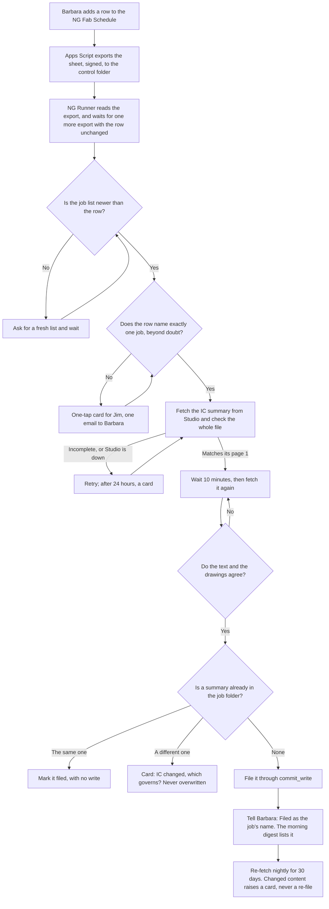
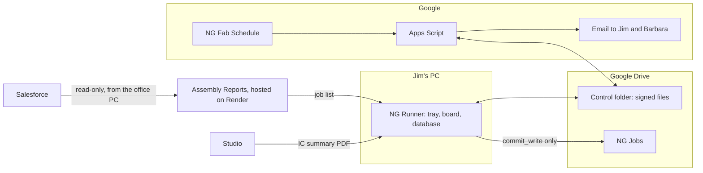
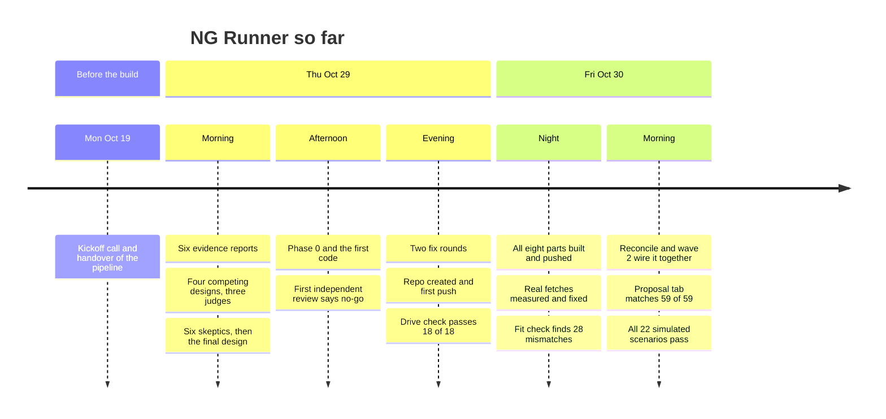

# NG Runner

NG Runner is a Windows tray app for the CNC office of Inspired Closets LA. When Barbara adds a job to the NG Fab Schedule, it finds the job in Salesforce, downloads its install report (the **IC summary**) from Studio twice, checks that the report is whole, matches its own page 1 and belongs to that job, and files it in the job's folder, without anyone touching a file. Whenever it can't be sure of something, it asks Jim with a one-tap card. It never guesses.

That is Phase 1a, the first step of a staircase. Later phases add read-only guards, shared checking tools, a button for locking a job and, only if a test on past jobs passes, overnight building of walls and verticals.

Built and supported by Sulaiman Ahmed, for Jim Delany, owner of Inspired Closets LA.

> **Status, 2026-10-31, 2:55 PM Pacific.** About 80% of the committed work (P0 to P3) is built, and 52% of all phases. **Phase 1a and Phase 1b are built and proven on real data on Sulaiman's PC. Phases 2 to 4 are well along:** the shared converter and its workbook equal Jim's chat on his recent jobs and are packaged for his toolkit; Jim's crosscheck runs on "sections done" with ready chat lines; and the lock, tracker drops and a first fixer are proven on real copies, writing nothing real before go-live. Phase 5's drawing reader is a conditional go with Claude. **Nothing is installed on Jim's PC.**

## Contents

- [Where it stands](#where-it-stands)
- [Why it exists](#why-it-exists)
- [What Phase 1a does](#what-phase-1a-does)
- [How it decides which job a row means](#how-it-decides-which-job-a-row-means)
- [What each person sees](#what-each-person-sees)
- [When things go wrong](#when-things-go-wrong)
- [The rules it never breaks](#the-rules-it-never-breaks)
- [How it is built](#how-it-is-built)
- [Timeline](#timeline)
- [Measured so far](#measured-so-far)
- [What comes next](#what-comes-next)
- [The later phases](#the-later-phases)
- [Working on the code](#working-on-the-code)
- [Repository map](#repository-map)
- [Client data and secrets](#client-data-and-secrets)

## Where it stands

| Stage | Share of the Phase 1a build | State |
|---|---|---|
| Foundations: safe writes, job matching, summary check | 20% | Built. Matching and the summary check were reworked after the third review's no-go, and wave 3's review looks at them again |
| The eight separate parts | 30% | Built. Reconcile and wave 2 worked through the 28 mismatches the fit check found ([docs/decisions.md](docs/decisions.md)) |
| Wiring into a running app, and the day simulation | 30% | Built. All 22 scenarios pass, on fakes only |
| Independent verification and fixes | 12% | Done on this PC: the three independent reviews all came back no-go, with 35 problems between them, some the same one seen twice (1 blocker, 11 high, 9 medium, 14 low). All are fixed and pushed, the worst proven in the real run, and 24 of 24 deliberate breaks of the fixes make a test fail |
| The installer build, the Apps Script and the test kit | 8% | Mostly: the kit is built and installs, its self-test and the Drive canary pass from the installed copy, and the Apps Script is live on real Google. No kit has gone to Jim's PC |

**About 97% of the Phase 1a build is done.** That is a judgment from the parts finished and the hours left, not a measurement. Across all phases it is about 12 of the design's 104 dev-days, or 20% of the 60 in the committed P0 to P3, a rougher guide, because the later phases aren't specified yet.

**In numbers, 2026-10-30, 9:45 AM Pacific:** about 20,800 lines of app code and 29,600 lines of tests. Wave 2 ended with 3,945 tests passing on Sulaiman's PC, none skipped.

**The day simulation runs end to end on fakes.** It drives the real pipeline, job model, supervisor and messenger on a fake clock, against a fake Studio, Render and Apps Script, and four of its scenarios run the real Apps Script files under node. It passed on its first full run with no mutation checks, so nothing yet shows that each assertion can catch a fault, and it calls each step directly rather than through the scheduler thread.

**Proven on real Google, 2026-10-30:** the Apps Script runs under the account that owns the Fab Schedule, in shadow mode. Its setup check came back clean and its five triggers installed. Its export reaches Sulaiman's PC through Drive for desktop every 5 minutes or so, and NG Runner's real code accepts its signature and reads all 91 rows, and refuses the file with one byte changed or with the wrong key. The watchdog's two emails reached Sulaiman. A signed message from the real code went out as email through the Apps Script, and its signed receipt came back in 20 seconds.

**The first real run, 2026-10-30, on Sulaiman's PC.** The real app, with 20 real Fab rows arriving as new, against the live job list, real Studio with its own Edge sign-in, and real Drive, with a stand-in NG Jobs folder in the test area so the real one couldn't be touched. It matched 16 rows and asked about 4. It filed all 11 auto-matched jobs by itself, each after two fetches 11 minutes or more apart, including one garage job under `<Job>_Gar`, the same folder name Jim uses for it. A separate audit found the right job on page 1 of all 11, no duplicates, and none of the 36 fetches failed the check. The other 4 jobs already had Jim's summary, and those copies were left untouched, each with a card asking what to do.

**The built `.exe`, 2026-10-30, on Sulaiman's PC.** Installed from the kit into a test folder. Its self-test passes, the Drive canary passes all 19 checks, and it signs in to Studio by itself through Edge. Running the real `.exe` found two problems that would have stopped Jim's install and that no fake could show: the build left out a module Windows' credential library imports by name, so it could read no key at all, and the canary couldn't remove its own test folders on Drive. Both are fixed, and the self-test now does a real credential round trip.

**The second real run, 2026-10-30, on the built `.exe`.** Another 20 real rows, against the same real services and a stand-in NG Jobs. In shadow mode 13 jobs were filed aside into the control folder and nothing was written to NG Jobs. A real card answered on the real board brought in a 14th job. The real go-live switch, in its two deliberate steps on the Health page, then handed the 13 back, and each went through fresh fetches and filed for real, 2 of them garage jobs under `<Job>_Gar`. A separate audit found the right job on page 1 of all 13. None of the 68 fetches failed the check, all 71 writes succeeded, and the log holds no errors. The 3 jobs where Jim's copy differs each hold a card that says what changed, and his copies were left untouched.

**Not proven yet:** anything on Jim's PC (filing into the real NG Jobs, Studio's sign-in, the file-system checks on his Google Drive, scheduled tasks under his account), the Apps Script's edit log and nightly clean-up, a real night's re-fetch and morning digest, and the auto-match rate over the shadow run, on rows as they arrive.

## Why it exists

Jim turns each IC summary into a Mozaik CNC job through his own AI chat sessions and a toolkit of about 170 scripts. Today he, or someone in the office, has to get each summary by hand: download it from Studio through the Assembly Reports app, then upload it to the chat. On the 2026-10-19 kickoff call he also said the app "always saves in the downloads folder", and asked for a report to reach the job folder by itself when Barbara adds a job.

Measured from the NG Jobs files on 2026-10-29, before NG Runner ([docs/baseline.md](docs/baseline.md)): only **42 of 88 job folders (48%)** hold the summary under the standard name.

**Why a desktop app.** Only a program on Jim's own PC can see Mozaik's lock files, his Google Drive and his OneDrive. A hosted dashboard can't, and a Windows service can't see drives that belong to his user account. So it is a tray app that starts when he logs on, installed for his account, with no admin rights needed.

**What it won't do.** Software can't remove the expert work. The design's estimate is that Jim's roughly 103 minutes per job becomes about 93 after Phase 1a and 50 to 54 at the very best, after Phase 5. Phase 1a's value is that the hunting, downloading and uploading stop, and that nothing is filed under the wrong job.

## What Phase 1a does



**What lands in the job folder**, `NG Jobs\<Name_MMDDYY>\`, with a made-up job:

| File | For | Contents |
|---|---|---|
| `Testerson_101426_summary.pdf` | Everyone | The checked IC summary |
| `Testerson_101426_NGRunner.json` | Jim's chat sessions | What was filed, its checksum, any open cards. The chat reads this first |
| `Testerson_101426_NGRunner_log.txt` | People | One plain line per event, for example `10/30 3:05 PM  Filed the IC summary (landscape, 19 pages), checked on two fetches 10 minutes apart.` |

**Closet or garage.** A garage-only summary goes to `<Name>_Gar\`. Closets only, or closets and garage mixed, go to `<Name>\`: a mixed summary is one job, as Jim's own rules say. A card comes only when a design can't be classified, or when the row or the job's name says garage and no design does, and only that job waits.

**The summary check** is deliberately hard to pass. It reads the whole file: every checksum, the file's index and its ending, and whether each design on page 1 has its pages and drawings. A partial render that looks fine, or a file damaged by one bit, is refused. Two fetches must then agree on both text and drawings, because a render can be consistent with itself and still be early. Two byte-identical fetches don't count: real renders always differ in bytes, so identical ones mean something served one render twice.

**What these checks can't prove.** They show that a report is whole, stable and true to its own page 1, not that it holds everything the job needs. So the report is also checked against a second list: on 59 of 59 real sold jobs, the designs on Studio's Proposal tab equal the report's page 1, and that check is being wired in. If the two differ, the job waits for a card from Jim; if Studio can't be read, it still files, marked "designs not cross-checked". That can't catch a design the designer left off the proposal, or a missing drawing inside a design: on 86 real reports, drawing pages often show several walls but carry one wall number, so the file can't show that every wall is drawn. Today's hand download has the same gap, so "Filed as" and the digest show each job's design and page counts for a person who knows the job, and a report that changes within 30 days of filing raises a card. Filing goes live only after the shadow run compares each report with what Jim actually builds ([AGENTS.md](AGENTS.md), Before filing goes live, item 8).

**Add job.** The board has a button for a job that never gets a row. It enters the same pipeline, with the same checks.

## How it decides which job a row means

This is where a wrong job would come from, so the rule is strict: a row files only when **every word in it is explained** and only one job can possibly be meant. Otherwise it asks. A question costs Jim one tap; a wrong job costs a wrong cut.

Only Ready to Order and Ready to Install count as sold. Complete never counts, or every job installed before NG Runner would be a candidate. All names below are made up.

| Barbara types | The list holds | Result | Why |
|---|---|---|---|
| `Testerson_101426` | That exact Opportunity | Files | Exact name |
| `Testerson` | One sold job of that surname and designer | Files | Every word explained; no rival |
| `Testerson closet` | The same | Files | "closet" is a room word |
| `Testerson Master` | The same | Asks | "Master" can be a second surname, so it isn't a room word |
| `Testerson` | Two sold jobs of that surname | Asks | Several fit |
| `Testerson` | A sold job, plus a newer `Pat Testerson_101426` still at Propose | Asks | Salesforce can lag behind the sale |
| `Testerson remake` | A sold job | Asks | It may be a new run of the job |
| `Testerson` | Designer initials that fit two owners | Asks | Shared initials count for nobody |
| A cell over 200 characters | Anything | Asks | Never read, so it can't stall the app |

A card remembers the Studio ID behind each of its buttons, so an answer given days later, after a restart and a new job list, still means the same job. If that job is no longer on the list, the board says so and the row stays asked.

## What each person sees

| Who | What they get | What changes for them |
|---|---|---|
| **Barbara** | "Filed as `<Job>`" by email. One email listing the candidates when a row is unclear | Nothing to learn: she types rows as she does now, and corrects a name in her own cell |
| **Jim** | A board in his browser (Board, Your list, Cards, History, Health), a tray icon, the 6:30 AM digest by email, and a pop-up for the two kinds of card that make a job wait | Summaries appear by themselves. No new app or account |
| **Jim's chat sessions** | The filed summary and `<folder>_NGRunner.json` | They work from the filed copy instead of asking for an upload. The rule changes are drafted in [docs/p1a/rules-lines.md](docs/p1a/rules-lines.md) and [docs/p1a/skill-update.md](docs/p1a/skill-update.md), and need Jim's OK |
| **Sulaiman** | A daily "ran" line, developer items, watchdog alerts and a support bundle | [docs/p1a/runbook.md](docs/p1a/runbook.md) lists every alarm with its one-line fix, so a backup developer could take over |

**Tray colours:** green when all is well, amber with a count when something needs Jim, red when NG Runner itself is unwell, grey when paused. Each also has its own mark, so no two states differ by colour alone.

**Messages to Jim** follow his format: numbered, one line each, no intro or sign-off. A lint rejects anything else, and in particular any path, hash, Studio ID or error text.

## When things go wrong

| What happens | What NG Runner does |
|---|---|
| A row is unclear | Card for Jim, one email to Barbara. Only that row waits |
| The job list is older than the row | Asks for a fresh list, at most once per 5 minutes, and waits. An alarm if it stays stale for over an hour |
| Studio is down, or the address isn't found | Retries after 5, 15, 30 and 60 minutes, then hourly. A card after 24 hours |
| The render is early and incomplete | Retries every 30 minutes |
| Studio returns another job's report | Files nothing. If the job list shows that name is this job's new name, it is a rename, and NG Runner fetches under it. Otherwise a card and a developer item at once |
| A summary is already in the folder | The same: marked filed, no write. Different: a card. **Never overwritten** |
| A job's folder was there at install, or has moved to `NG Jobs\Old` | Writes nothing into it, never makes a second one, and the board says why |
| Someone replaced a filed summary by hand | Logged, never overwritten, and the notes are rewritten to describe the file that's there |
| The sheet suddenly loses or gains many rows | Holds that export until the next one says the same, so a half-loaded sheet starts nothing |
| NG Runner crashes or the PC restarts | Picks up where it stopped, with no duplicate file, message or card |
| The PC is off | The Apps Script watchdog notices the missing heartbeats and tells Sulaiman. Missed work is done at the next start, and named: "Missed the 6:30 AM digest: the PC was off. Sent at 8:12 AM" |
| Paused (tray, board or a signed file) | Files nothing. Heartbeats, the digest and messages go on |
| A new version fails to start twice | The launcher falls back to the previous version and tells Sulaiman |

**Silence is never success.** A dead PC, a missed message or an unverified value is shown as such. What can't be verified reads "could not verify".

## The rules it never breaks

The full list is in [AGENTS.md](AGENTS.md).

1. **One door for writes.** Everything written outside NG Runner's own data folder goes through `commit_write()`. It checks that the path is allowed, by file identity and not by name, that the file is still what NG Runner last wrote, and it backs up, writes to a temp file, renames and reads back. If any step fails, the whole commit rolls back.
2. **It deletes nothing it didn't just create,** and each removal is checked by identity first.
3. **It never writes while Mozaik could be using the files.** It waits; it never forces. Phase 1a writes nothing a Mozaik job reads, and this check joins the door in Phase 1b.
4. **Code decides.** No AI model takes part in any verdict, gate, message or parser. The only AI use planned is reading elevation drawings in Phase 5, and every value it reads must be confirmed by code from another source.
5. **Jim's rules come from his toolkit.** They are called or ported, never retyped. Where his documents disagree, it's raised as a question, never picked silently.
6. **It never guesses.**
7. **Salesforce is read-only, and NG Runner never talks to it directly.** It reads a list published by the Assembly Reports app, without emails or Salesforce IDs.
8. **No client data and no secrets in git.** See [below](#client-data-and-secrets).

## How it is built



**Stack:** Python 3.14, packaged with PyInstaller into a folder build of about 74 MB. SQLite for its record, Flask and waitress for the board on `127.0.0.1`, pystray for the tray, and pypdf for reading PDFs. Google Apps Script for everything on Google's side. Secrets sit in Windows Credential Manager.

### The parts

| Part | What it does | State |
|---|---|---|
| [`ngrunner/writes.py`](ngrunner/writes.py) | The one door for writes | Built, passed independent review; the SQLite write record came after it |
| [`ngrunner/match.py`](ngrunner/match.py) | Matches rows, files and folders to jobs | Built, reworked after the third review; wave 3's review looks again |
| [`ngrunner/intake/summary_check.py`](ngrunner/intake/summary_check.py) | The strict whole-file check and the content fingerprint | Built, reworked after the third review; wave 3's review looks again |
| [`ngrunner/intake/fetch.py`](ngrunner/intake/fetch.py) | The Studio download and the two-fetch agreement | Built, tried on real jobs |
| [`ngrunner/intake/studio_designs.py`](ngrunner/intake/studio_designs.py) | Checks a report's designs against Studio's Proposal tab | Being finished and wired in; the comparison matches 59 of 59 real reports |
| [`ngrunner/intake/branch.py`](ngrunner/intake/branch.py) | Closet or garage | Built; a mixed summary is one job, as Jim's rules say |
| [`ngrunner/joblist.py`](ngrunner/joblist.py) | Reads the job list from Assembly Reports, and refuses a bad one whole | Built; the route it calls is pushed to Assembly Reports |
| [`ngrunner/fab.py`](ngrunner/fab.py), [`google/`](google/) | The Fab Schedule export, edit log, outbox, watchdog and prune | Built, tested under node, never run on live Google |
| [`ngrunner/store/`](ngrunner/store/) | The SQLite record, with migrations | Built |
| [`ngrunner/messages/`](ngrunner/messages/), `cards.py`, `digest.py`, `heartbeat.py` | Templates, the format lint, cards, the digest | Built |
| [`ngrunner/board/`](ngrunner/board/), `tray.py`, `toasts.py` | What Jim sees | Built; real tray and toasts untested |
| `launcher.py`, `single.py`, `selftest.py`, `backup.py`, `support.py` | Falling back to the last good version, one running copy, the self-test, encrypted backups, support bundles | Built, tried in the real build |
| [`installer/`](installer/), [`ngrunner.spec`](ngrunner.spec) | Install and uninstall scripts, scheduled tasks, the build | Built; never registered on a real account |
| `clock.py`, `signing.py`, `config.py`, `secrets.py` | Pacific time, signed files, settings, keys | Built |
| `intake/pipeline.py`, `interlock.py`, `jobmodel.py`, `supervisor.py`, `messenger.py`, `canary.py`, `tools/sign_pause.py` | The wiring that makes it one running app | Built; runs end to end on fakes only |
| [`tests/fakes.py`](tests/fakes.py), [`tests/test_e2e_day.py`](tests/test_e2e_day.py) | The day simulation: 22 scenarios on a fake clock | All pass |

### The control folder

A private Google Drive folder that NG Runner and the Apps Script use to talk. Every message between them is a signed envelope (HMAC-SHA256), checked on arrival, with a shared test vector proving both sides seal the same bytes. Logs, backups (encrypted), support bundles and shadow files are plain copies kept there.

| Path | Written by | Holds |
|---|---|---|
| `fab/export.json`, `fab/edits.json` | Apps Script | The sheet's rows, and Barbara's edits |
| `outbox/<id>.json` | NG Runner | A message to send |
| `receipts/<id>.json` | Apps Script | Proof it was sent |
| `heartbeat/<YYYYMMDD>/<seq>.json` | NG Runner | I'm alive, every 5 minutes |
| `pause/<id>.json` | Sulaiman | A pause, remotely. Resuming happens only at the PC |
| `logs/`, `backups/`, `support/` | NG Runner | Daily logs, encrypted backups, support bundles |
| `shadow/<folder>/` | NG Runner | What it would have filed, during the shadow run |

## Timeline

All times are Pacific. The test count is what a clean checkout holds at that commit, and the code columns count Python lines.



### Monday 2026-10-19: the handover

Kickoff call with Jim, Mary, Nicole and Sulaiman. Jim hands over his IC-to-Mozaik pipeline. His ask: when Barbara adds a job, the report reaches the job folder by itself, and the pipeline runs unattended, with Jim making the decisions.

### Thursday 2026-10-29: from a spec to code

| Time | What happened | Result |
|---|---|---|
| 7:47 AM | **Understand.** Six evidence reports: Jim and how he communicates, a map of the pipeline's stages, what is really on disk, the risks, unattended automation and the Windows platform | The goal changes: it must be an app on Jim's PC, started by a new job and not by a chat |
| 9:29 AM | **Design.** Four competing designs, three judges, one synthesis | Code decides, one door for writes, Jim decides by click, relief first |
| 11:13 AM | **Attack the design.** Six skeptics try to break it, then a revision | The final design: phases P0 to P5, about 104 dev-days. Local only, because it names clients |
| 1:11 PM | **First code.** Phase 0's read-only PC check and the first three parts: the write door, matching and the summary check | 264 tests pass |
| 3:22 PM | **First independent review** | **No-go** on writes (a folder swap during a wait could send a write outside its allowed folder; clean-up could delete links) and on matching (wrong "exact" matches) |
| 3:37 PM | **Fix rounds 1 and 2** | 597 tests by 8:13 PM. Writes: go. The summary check becomes a strict whole-file check. Matching: **still no-go**, since a free-text row could match the wrong family |
| 8:33 PM | **Fix round 3**, with a new rule for matching: every word must be explained | Whack-a-mole ends. 505 matching tests, with results on the real files unchanged |
| 9:32 PM | Repository created on GitHub | [`7b76cc0`](https://github.com/sulaiman013/NG-Runner/commit/7b76cc0) |
| 9:43 PM | **Eight parts start in parallel,** against [docs/p1a/build-spec.md](docs/p1a/build-spec.md), each owning its own files | Runs through the night |

| Pushed | Commit | What it did | Tests | App lines | Test lines |
|---|---|---|---|---|---|
| 10:26 PM | [`d1b60e9`](https://github.com/sulaiman013/NG-Runner/commit/d1b60e9) | First push: Phase 0 and the three foundations | 873 | 3,656 | 5,092 |
| 10:48 PM | [`bd17e4a`](https://github.com/sulaiman013/NG-Runner/commit/bd17e4a) | Default decisions replace the questionnaire, and short test windows are planned for Jim's PC | 875 | 3,656 | 5,092 |
| 10:58 PM | [`3773da7`](https://github.com/sulaiman013/NG-Runner/commit/3773da7) | The baseline is measured from the NG Jobs files instead of asking Jim | 882 | 3,854 | 5,166 |
| 11:05 PM | [`a9376c1`](https://github.com/sulaiman013/NG-Runner/commit/a9376c1) | The access list folds into the test windows | 882 | 3,854 | 5,166 |
| 11:22 PM | [`d8e512a`](https://github.com/sulaiman013/NG-Runner/commit/d8e512a) | **The biggest unproven assumption is proven:** the write door's file-system checks pass on Google Drive, 18 of 18 | 882 | 3,854 | 5,166 |
| 11:34 PM | [`9fb74cd`](https://github.com/sulaiman013/NG-Runner/commit/9fb74cd) | Drafts of the rule changes for Jim's chat. Checking against his own rules also caught a spec error: mixed closet-and-garage jobs are one job | 901 | 3,854 | 5,500 |

### Friday 2026-10-30: the parts meet the real world

| Time | What happened | Result |
|---|---|---|
| 12:24 AM | **Third independent review** | Writes: go. Matching: no-go on two serious findings. Summary check: no-go, since one bit could hide damage to a drawing |
| 2:03 AM | Wave 1 pushed: [`e19375a`](https://github.com/sulaiman013/NG-Runner/commit/e19375a). 146 files, 2,332 tests, 13,499 app lines, 14,072 test lines | Before this push, a stricter scan caught real client names copied into a test comment. **They never reached GitHub,** and any file naming a client from Jim's documents or the design now fails the suite |
| 2:09 AM | **First real measurement.** Real jobs fetched from Studio twice, 10 minutes apart | 6 of 6 agree on their text and all 105 drawings, and no pair is byte-identical |
| 2:40 AM | **Real sold jobs.** The 60 most recently changed, one at a time | 56 fetch, and all 56 pass the strict check. **4 can't be found** |
| 3:05 AM | The cause: Studio keeps hyphens in its addresses, and some account names carry a street address | Fixed and proven on those jobs: **59 of 60 now fetch** |
| 3:14 AM | Pushed: [`54689e6`](https://github.com/sulaiman013/NG-Runner/commit/54689e6) | 2,343 tests |
| 3:25 AM | **Auto-match on the real list** of 10,643 Opportunities | 60% of newly sold jobs auto-match. **None match the wrong job,** and the rest ask |
| 3:26 AM | **The fit check.** One reviewer reads all eight parts together | All tests pass, yet it finds **28 places where the parts wouldn't work together,** 7 of them serious. For example, Jim would have had a false "No list today" alarm every morning of the shadow run, and a card didn't remember which job each button meant |
| 3:28 AM | Pushed: [`439896a`](https://github.com/sulaiman013/NG-Runner/commit/439896a). A check of the real build found **the built app failed its own self-test,** so no install could have succeeded. The tests were green because they faked the broken call | Fixed and proven in the real .exe, with a new self-test test that fakes nothing. 2,384 tests, 13,621 app lines, 14,454 test lines |
| 3:30 AM | **Reconcile.** Six owners close those mismatches | Pushed at 6:42 AM: [`91a0c39`](https://github.com/sulaiman013/NG-Runner/commit/91a0c39) |
| 5:50 AM | **Assembly Reports goes live** with the address fix and the job-list route for NG Runner: [`4789456`](https://github.com/sulaiman013/icla_assembly_report_app/commit/4789456), [`56edd05`](https://github.com/sulaiman013/icla_assembly_report_app/commit/56edd05) | The 3 sold jobs that used to fail download on the live app. The deploy emptied the live job list for about 12 minutes, because the office PC's publisher was starved of CPU by this build |
| 6:28 AM | **Wave 2 starts:** the pipeline, job model, supervisor, messenger, canary and write record, proven by a simulated day | Runs in parallel, each owner with its own files |
| 7:24 AM | Pushed: [`415448e`](https://github.com/sulaiman013/NG-Runner/commit/415448e) | Google clean-up and digest fixes, the Apps Script guide and the test kit builder. 3,180 tests |
| 7:37 AM | Pushed: [`d9d60b3`](https://github.com/sulaiman013/NG-Runner/commit/d9d60b3) | The Apps Script moves to the account that owns the Fab Schedule |
| 7:58 AM | Pushed: [`ddfb223`](https://github.com/sulaiman013/NG-Runner/commit/ddfb223) | The checks say what they can and can't prove |
| 8:38 AM | **Studio's Proposal tab** against the real reports | Matches 59 of 59 |
| 8:51 AM | **Wave 2 finished** | All 22 day-simulation scenarios pass, on fakes, with no code fixes needed. A read of the code still found 8 problems no scenario hits |
| 9:12 AM | **The Studio check, live with the real code:** Edge signs in by itself through the community site in 24 seconds | 59 of 59 real sold jobs match. The one sold job the derived addresses missed fetches through its Studio page's link, so **60 of 60 sold jobs now fetch** |
| 9:15 AM | Pushed: [`3fefdce`](https://github.com/sulaiman013/NG-Runner/commit/3fefdce) | The running app. 3,945 tests on a clean checkout |
| 9:44 AM | Pushed: [`766359f`](https://github.com/sulaiman013/NG-Runner/commit/766359f) | README, specs and runbook catch up with the running app. 296 doc and support tests |
| 9:58 AM | **The real Fab Schedule** against the live job list, each row treated as new | **67 of 91 rows auto-match (74%),** including all 4 rows with an upcoming install date. 55 of the 67 have an NG Jobs folder under that same name. The other 24 ask |
| 9:58 AM | The 8 fixes, the last rulings and the Studio check are written, and **three independent reviews start** | Running |
| 10:22 AM | **The Apps Script goes live** on the real account, in shadow mode | Setup check clean, five triggers installed, both watchdog emails reach Sulaiman |
| 10:42 AM | **First real Google-to-NG Runner test:** the real signed export, through Drive for desktop, opened by the real code | Signature good, 91 rows, and the file with one byte changed or the wrong key is refused. 67 of 91 auto-match, the same as the direct read |
| 11:02 AM | **Safety review: no-go** | 12 problems. The worst: a Studio sign-in that hangs stops all filing and tells nobody, and one path in shadow mode can write into the real NG Jobs. Found on a scratch copy with fakes |
| 11:41 AM | **The message loop, for real:** signed message, real Apps Script, real email, signed receipt | Receipt in 20 seconds, signature good, email received |
| 11:44 AM | **Running-app review: no-go** | 9 problems, including go-live leaving shadow-filed jobs reading "Filed" with nothing in NG Jobs |
| 11:51 AM | **The first real jobs filed,** by NG Runner itself, into a stand-in folder on real Drive | Real Studio, real job list, real Drive, two fetches each |
| 11:58 AM | **Break-the-code review: no-go** | 14 problems, mostly tests that can't fail where a deadline or a card answer goes wrong |
| 12:01 PM | **All 11 auto-matched jobs filed** | A separate audit: right job on page 1 of all 11, no duplicates, none of the fetches failed the check |
| 12:13 PM | **What only real data could show** | Studio's reports change by themselves: 3 of Jim's 4 copies now differ from today's fetch in rod part numbers only, with identical drawings. And multi-day installs (`10/29-30`) couldn't be read, on 13 of 91 real rows; fixed, now 84 of 91 read |
| 12:43 PM | Pushed: [`ebd3d86`](https://github.com/sulaiman013/NG-Runner/commit/ebd3d86) | Multi-day installs, and the first real run recorded. 3,956 tests on a clean checkout |
| 1:11 PM | **The reviews' fixes finished** | All 35 problems handled, on fakes |
| 1:38 PM | **The built `.exe` installed from the kit,** with the Drive canary from the installed copy | The canary failed on real Drive: Drive adds a hidden `desktop.ini` to each folder, so it couldn't remove its own. Fixed: 19 of 19 |
| 2:01 PM | **The built `.exe` run on real services** | It could read no key at all: the build left out a module Windows' credential library imports by name, and the self-test only imported modules. Fixed, and the self-test now reads a real credential |
| 2:39 PM | Pushed: [`56d512b`](https://github.com/sulaiman013/NG-Runner/commit/56d512b) | All the fixes, the design check, and the card saying what changed. **4,310 tests on a clean checkout** |
| 2:41 PM | **Studio sign-in from inside the built `.exe`,** forced by clearing its session and answering a real card on the real board | Signed in by itself and saved the session |
| 2:44 PM | **Shadow mode on the built `.exe`** | 13 jobs filed aside into the control folder, and nothing written to the stand-in NG Jobs: the reviews' worst finding, fixed for real |
| 2:50 PM | **The fixes, broken on purpose, one line at a time** | 15 of 24 made a test fail. The other 9 ran against too few tests or had none, so tests were added: now 24 of 24 |
| 2:58 PM | **The real go-live switch** on the real Health page | It asks first, then all 13 trial-filed jobs go back for fresh fetches, logged as "being filed for real" |
| 3:15 PM | **13 of 13 filed for real** into the stand-in NG Jobs, with Barbara's "Filed as" queued for each | Right job on page 1 of all 13 by a separate audit. 0 of 68 fetches failed the check, 71 of 71 writes succeeded, no errors in the log |
| 3:25 PM | **A shadow run starts on Sulaiman's PC** against the real control folder, so a real morning digest reaches his email and real new rows are measured as they arrive, while Jim is away | Running |
| 4:43 PM | **Phase 1b's build spec,** measured on the real files on Drive | 1,663 of 1,663 CNC programs read. They show both nest defects, so the guard can start without Jim's toolkit. Nest files can't be read on this PC |
| 6:56 PM | Pushed: [`e9721a0`](https://github.com/sulaiman013/NG-Runner/commit/e9721a0) | Phase 1b's parts: program reader, sheet size, tracker pre-flight, order heads-up, per-material state. **5,428 tests on a clean checkout** |
| 9:30 PM | **The guards on the built `.exe`,** with real faulty programs posted under made-up names to a stand-in folder | DO NOT CUT within 2.5 minutes on both, a real card, and the app's own emails sent through the real Apps Script with receipts read back |
| 9:37 PM | **Clearing a fault, for real** | A click on the real board cleared only the sheet size. Doubled holes stayed red until a clean program was posted |
| 9:45 PM | Pushed: [`b8f57e8`](https://github.com/sulaiman013/NG-Runner/commit/b8f57e8) | The guards wired into the app. **5,602 tests on a clean checkout** |
| 9:50 PM | Pushed: [`0821311`](https://github.com/sulaiman013/NG-Runner/commit/0821311) | The board's ticks wrap, and the README records Phase 1b's first real results |
| 10-31, 12:28 AM | **The shadow run reads the real NG Jobs,** on Sulaiman's yes, still in shadow mode | 536 programs and 91 rows taken as the baseline, nothing alarmed, nothing written there |
| 12:56 AM | **A real morning digest,** sent early on purpose | Sent through the Apps Script, receipt read back, reached Sulaiman |
| 1:20 AM | **Jim's toolkit arrives on Drive:** his 183 scripts, docs, regression jobs, material libraries and 10 whole Mozaik job folders | Unpacked locally, kept out of git, never run in place |
| 1:33 AM | **Jim's two nest checks, run on copies of the 10 real jobs** | On doubled cam holes they agree with NG Runner's program reader on every job. On sheet size each catches faults the other can't, so both run |
| 3:45 AM | **The drawing-reading test (P2), built up to the model call** | 41 drawings prepared from real summaries, none with any text over it, and 26 walls paired with what was really cut. It waits for a provider key |
| 4:39 AM | Pushed: [`784170b`](https://github.com/sulaiman013/NG-Runner/commit/784170b) | Phase 1b's nest guard finished: real nest files, Jim's two checks, who holds a job, plus the tracker inbox writer and the `.bak` check. 6,166 of 6,167 tests on a clean checkout; the one timing test was made to retry on a busy PC |
| 5:39 AM | Pushed: [`be665d0`](https://github.com/sulaiman013/NG-Runner/commit/be665d0) | **Phase 2's shared converter**, IC summary to takeoff. It leaves what the rules don't decide as "could not verify", and matches Jim's frozen jobs exactly. **6,552 tests on a clean checkout** |
| 1:30 AM | **The first real night's work, in shadow on real NG Jobs** | It ran on time, and its "ran" and DEV lines reached Sulaiman by email, with receipts read back |
| 6:47 AM | **The morning check of the overnight shadow run** | Still running, still in shadow. NG Jobs is file for file as it was at 12:28 AM, and NG Runner wrote nothing there. No new rows or programs came in overnight, so no alarm, false or real. No errors or warnings in the log |
| 7:00 AM | **Jim's own regression, on Windows, on a safe copy of his toolkit** | It passes unchanged: his 3 frozen jobs reproduce. It also ran inside a private build of the `.exe` |
| 7:10 AM | **Nests against their saved designs** | On the 10 real jobs, the design check finds what Jim's tools can't: grooves flipped, pull holes hidden, parts resized, and a whole room added after nesting. Two good jobs reach "Nest checked" |
| 7:40 AM | **Jim's crosscheck, run by NG Runner on all 10 real jobs** | NG Runner understands every line his checkers print, and on 4 jobs they print exactly what his own runs did |
| 8:10 AM | **The takeoff on intake** | Of 52 real summaries, 34 give a complete takeoff, 12 leave lines to Jim, and 6 garage or mixed jobs stay in chat. An incomplete one falls back to the chat's whole list |
| 9:25 AM | Pushed: [`558ac5b`](https://github.com/sulaiman013/NG-Runner/commit/558ac5b) | Toolkit adoption, the design match, the check runner and the takeoff on intake. **6,931 tests on a clean checkout** |
| 9:37 AM | **The shadow run upgraded to this build** | Its data carried over, the database upgraded cleanly, still reading the real NG Jobs in shadow |
| 11:27 AM | **The drawing test on 26 real walls,** GPT-6 Luna through OpenRouter and Claude Opus 5.5 direct | Claude reads every vertical right; its misses are positions Jim chooses when he builds. Luna makes reading mistakes of its own. A conditional go on P5 with Claude |
| 12:00 PM | **The converter packaged for Jim's toolkit** | It passes Jim's own regression; its workbook equals the chat's on 14 recent jobs. On Drive for his review |
| 1:00 PM | **Phase 3's checks and Phase 4's lock** | Jim's crosscheck on all 10 real jobs, each fault a ready chat line; one real fixer with Undo to the exact bytes; nothing real written |
| 1:30 PM | **40 more real jobs arrive** for the drawing test | Unpacked locally, never in git |
| 2:51 PM | Pushed: [`71e1f1e`](https://github.com/sulaiman013/NG-Runner/commit/71e1f1e) | The workbook and delivery, Phase 3's checks and Phase 4's lock. **7,473 tests on a clean checkout** |
| 2:55 PM | **Now:** Phase 3 and 4 wired into the board, and the drawing test on the new jobs, with Luna being tuned | Running |

## Measured so far

Real files were read only, and nothing here required touching Jim's PC.

| What | Result | When |
|---|---|---|
| The write door's file-system checks on Google Drive, in a test folder | 18 of 18 | 10-29 |
| File and folder IDs stay stable while Drive syncs | Yes, at 5, 30 and 60 seconds | 10-29 |
| Writes that must be refused | 20 of 20 refused | Every self-test |
| Two real fetches, 10 minutes apart | 6 of 6 jobs agree on text and all 105 drawings; none byte-identical | 10-30 |
| Real sold jobs that fetch | 60 of 60 (7 to 95 seconds each), the last through its Studio page's report link | 10-30 |
| Real renders the strict check wrongly refuses | 0 of 59 | 10-30 |
| Reports whose designs match Studio's Proposal tab, by name, with the real code and a live sign-in | 59 of 59 (124 designs on each side, 202 on the projects) | 10-30 |
| Studio's Proposal tab against the report's page 1 | 59 of 59 jobs match, 124 designs on each side; those projects hold 202 | 10-30 |
| Auto-match, jobs dated in the list's last 30 days | 32 of 53 (60%) | 10-30 |
| Auto-match, last 90 days | 64 of 116 (55%) | 10-30 |
| Auto-match, all 628 sold jobs | 307 (49%) | 10-30 |
| **Matches to the wrong job in all of those** | **0** | 10-30 |
| Auto-match on the real Fab Schedule, 91 rows against the live job list of 10,781 | 67 (74%): 62 by exact name, 5 by surname and designer | 10-30 |
| Of those 67, with an NG Jobs folder under the same name | 55. The other 12 have none, which doesn't show them right or wrong | 10-30 |
| Real rows with an upcoming install date that auto-match | 4 of 4 | 10-30 |
| The Apps Script's signed export, read by the real code through Drive for desktop | Accepted, 91 rows. Refused with one byte changed and with the wrong key | 10-30 |
| A signed message through the real Apps Script to real email, with its signed receipt | Receipt in 20 seconds, email received | 10-30 |
| Real jobs filed by NG Runner itself: real Studio, job list and Drive, into a stand-in folder | 11 of 11 auto-matched. Right job on page 1 of all 11 by a separate audit, no duplicates | 10-30 |
| Fetches in that run failing the summary check | 0 of 36 | 10-30 |
| Jim's own summaries against a fresh fetch | 4 of 4 differ: 3 in rod part numbers only, drawings identical, and 1 a real redesign | 10-30 |
| Install Date cells on the real sheet read as a date | 84 of 91, up from 72. The rest are blank, a note, or a weekday that doesn't match its date | 10-30 |
| The Drive canary, from the installed copy, on real Drive | 19 of 19 | 10-30 |
| Studio sign-in from inside the built `.exe` | Works, by itself, through Edge | 10-30 |
| The built `.exe`: jobs filed aside in shadow, writing nothing to NG Jobs | 13, with NG Jobs unchanged | 10-30 |
| The built `.exe`: those jobs filed for real after the go-live switch | 13 of 13, right job on page 1 of all 13 by a separate audit | 10-30 |
| Fetches in that run failing the summary check | 0 of 68 | 10-30 |
| Deliberate breaks of the final safety fixes that make a test fail | 24 of 24 | 10-30 |
| Real CNC programs read by the guard's reader | 1,663 of 1,663 | 10-30 |
| Programs with doubled cam holes, before and after Jim's 10-20 fix | 278 of 1,368 before, 0 of 67 after (a small sample) | 10-30 |
| The guards on the built `.exe`: real faulty programs caught | 2 of 2, within 2.5 minutes, with a false alarm on neither clean re-post | 10-30 |
| Doubled cam holes: NG Runner's program reader against Jim's own nest check | Equal on all 20 real materials | 10-31 |
| Real Mozaik nest files read | 20 of 20, with the same sheet counts Jim's check printed | 10-31 |
| Jim's frozen jobs through NG Runner's converter | 2 of 3 equal on parts, area, sheets and tape. The third differs by a door and a rail cover the rules leave to Jim | 10-31 |
| Jim's regression on a copy of his toolkit, on Windows | Clean: his 3 frozen jobs reproduce | 10-31 |
| Real nests that reach "Nest checked" with the toolkit adopted | 2 of 20, the two whose nest is the saved design and whose checks pass | 10-31 |
| Real summaries the converter turns into a takeoff equal to the chat's | 17 of 23 outright. With the lines it marks "could not verify" added back, the count equals the chat's on all 23 | 10-31 |
| Deliberate breaks of Phase 1b's safety lines that make a test fail | All of them, across 4 builders, each after closing what the first round missed | 10-30 |
| Matching: deliberately broken copies of the code that the tests catch | 50 of 50 | 10-30 |
| Build size and time | 74 MB, 45 seconds | 10-30 |

**How to read the auto-match numbers.** Each sold job was typed the way Barbara usually types it, a bare surname with the designer's initials, against the local job list of 2026-09-15. The rest aren't failures: they become one-tap cards. The real Fab Schedule's rows were then read once, each treated as new, which gave 74%. No person has checked those 67 matches, so that run gives no count of wrong ones. The shadow run measures both, on rows as they arrive.

**What zero errors proves.** Not much, on a small sample: zero wrong in 10 jobs still allows a true error rate of up to 26%, and 15 jobs up to 18%. That's why the design rests on per-item checks and doesn't claim safety from a clean run.

## What comes next

Rough estimates of build time. Earlier estimates ran long, so expect the upper end or beyond.

| Step | What | Estimate |
|---|---|---|
| The design check and the last rulings | Wire in Studio's Proposal tab and the design and page counts, and fix what wave 2's proving run found ([docs/decisions.md](docs/decisions.md)) | Written, pushed with verification |
| Verification | Independent review of the running app, breaking the code on purpose to prove the tests can fail, and fixes | Done, on fakes |
| Release | The real build and its self-test, the canary from the installed copy, and the test kit | Done. Rebuilt whenever the code changes |
| A second real run on Sulaiman's PC | The same real run with the fixed code and the built `.exe`, in shadow and then through the real go-live switch | Done |
| **A shadow run on Sulaiman's PC** | The built `.exe` against the real control folder and the real Fab Schedule, with a stand-in NG Jobs, so a real night's re-fetch and a real morning digest reach his email, and new rows are measured as they arrive | Running until Jim's PC takes over |
| Say what changed | The "IC summary differs" card says what differs, part lines or drawings, since a catalog change in Studio can raise one on every job with that part | Done |

**Then on Jim's PC,** in short scripted windows that stay out of his way ([docs/testing/jims-pc.md](docs/testing/jims-pc.md)). Every window says how long it takes, what it changes and how to undo it.

| Window | Takes | What happens | Passes when |
|---|---|---|---|
| 1. First look | 15 minutes, Jim present | Remote access and the read-only Setup Check. This doesn't need the build, so it can happen any time | The report is read, and decides signing |
| 2. Install | 20 minutes, remote | Install, self-test, the canary on his Drive, settings, keys and the Studio login, start in shadow mode | Self-test clean, canary passes, tray says SHADOW |
| 3. Shadow run | 1 to 2 weeks, unattended | Everything except writing to NG Jobs. Files go to a side folder, and every message goes to Sulaiman only | 0 rows matched to the wrong job, and every other row asked for a sensible reason |
| 4. Go live | 5 minutes, remote | Switch shadow off, on the board and in the Apps Script | Then 10 working days against the exit criteria |

**Phase 1a is done when, over 10 working days:** every new row is filed within 45 minutes or carded; **0 summaries are filed to the wrong job;** the board is right on 10 jobs Jim picks; 10 of 10 digests arrive; a sleep test alerts Sulaiman within 50 minutes; 20 of 20 forbidden writes are refused; and the restore drill passes.

**Needed from people first:**
- Jim's and Barbara's addresses in the Apps Script, at go-live. The script itself is live under the account that owns the Fab Schedule ([docs/testing/apps-script-setup.md](docs/testing/apps-script-setup.md)), and `ASSEMBLY_EXPORT_KEY` is set on Render.
- A new signing key before go-live, in the Apps Script and on Jim's PC.
- The Studio login NG Runner will use, for `NGRunner.exe setup` in window 2.
- 15 minutes with Jim for window 1.

## The later phases

From the design. Phases P0 to P3 are the committed scope. Each phase stands by itself, so Jim keeps what's built if work stops. Phase 5 is a separate go or no-go.

| Phase | Dev-days | Ships | State |
|---|---|---|---|
| **P0 Prepare** | 3 | Setup Check, baseline, default decisions | Done, apart from running the Setup Check on Jim's PC |
| **P1a File it** | 10 | Summaries filed by themselves, the board, the digest, the heartbeat | **In progress** |
| **P1b Guards** | 11 | Read-only guards: the nest guard with DO NOT CUT, a lock pre-flight, an order heads-up | **Built, about 95%.** "Nest checked" is reached for real on the jobs that earn it. Left: a 30-minute Mozaik session with Jim, and proving it on his PC. Earlier: built, about 85%. Reads real programs and nests, runs Jim's two checks on a safe copy, and agrees with them on all 20 real materials for doubled holes. Left: the nest-to-design match (being built), and a 30-minute Mozaik session with Jim. Earlier note: What can run from Drive's programs and tracker is built, wired and pushed, and proven on the built app. The parts that read Mozaik's own files wait for Jim's toolkit zip |
| **P2 One toolkit** | 18 | Shared tools go into Jim's chat, so it stops writing per-job scripts. A test on past jobs decides P5 | **About 80%.** The workbook equals the chat's on 14 recent jobs, and the converter is packaged for Jim's toolkit, passing his regression. Left: Jim's review and install of it, and the drawing test's last round. Earlier: about 55%. Adoption through Jim's regression, the check runner, the converter, the tracker inbox and the script comparison are built. Left: the workbook, delivering the shared tools into his toolkit, and the drawing test's model runs (they need a provider key). Earlier: started, about 35%. The shared converter (IC summary to takeoff), the tracker inbox writer and the script comparison are built. The drawing-reading test is built up to the model call, and waits for a provider key. Adopting Jim's toolkit through his own regression is being built |
| **P3 Checks and takeoff** | 18 | Checks run on "sections done", and the takeoff is done on intake | **About 55%.** Jim's crosscheck runs on "sections done" and on Check now, each fault a board item with a ready chat line, and items can be settled. Left: wiring into the board, trials against chat on Jim's PC, and the Mozaik-side parts. Earlier: about 25%. The takeoff on intake and its order heads-up are wired in, and the `.bak` reader is built. Left: checks on "sections done", the audit of chat-built jobs, repair items, and the Mozaik-side trials. Earlier: started, about 10%. The `.bak` reader is built, and the takeoff on intake is being wired in |
| **P4 Lock and fixes** | 16 | Lock, tracker and fixes run from NG Runner | **About 50%.** The lock gate, the tracker's checks before and after a drop, the job sheet and one real fixer with exact Undo are proven on real copies. Nothing real is written before go-live. Left: wiring into the board, and Jim's approvals |
| **P5 Ready for sections** | 28, only on go | Walls and verticals built overnight, with an AI model only reading drawings and code confirming every value | **Conditional go** (10-31): Claude reads every vertical's order, height and spacing right on 26 real walls; positions Jim chooses when he builds come from his rules. Being tested on 40 more jobs, and GPT-6 Luna is being tuned |

**Jim's minutes per job, the design's estimate:**

| Today | P1a | P1b | P2 | P3 | P4 | P5a | P5b |
|---|---|---|---|---|---|---|---|
| ~103 | 93 | 91 | 83 | 77 | 69 | 61 | 50 to 54 |

## Working on the code

Windows 11 and Python 3.14. Node is optional: without it, the Apps Script tests skip.

```powershell
python -m venv .venv
.\.venv\Scripts\python.exe -m pip install -e ".[dev]"
.\.venv\Scripts\python.exe -X warn_default_encoding -m pytest -q                     # all tests
.\.venv\Scripts\python.exe -X warn_default_encoding -m pytest -q -m "not fixtures"   # made-up data only
```

The tests refuse to start without `-X warn_default_encoding`, because it's what catches a file opened without `encoding="utf-8"`.

**Real-file tests** are marked `fixtures`. They read material that never enters git, name real files by index or count only, and skip when it's absent.

| Variable | Default | What |
|---|---|---|
| `NGR_FIXTURES` | `.local-fixtures\` | Real IC summaries |
| `NGR_NG_JOBS` | Found on `G:` | The NG Jobs folder, read-only |
| `NGR_SPEC_DIR` | Beside this repo | Jim's spec snapshot |
| `NGR_DESIGN_DIR` | Beside this repo | The design, which names clients |

**The build** goes outside the repo:

```powershell
.\.venv\Scripts\python.exe -m PyInstaller ngrunner.spec --noconfirm --distpath <out>\dist --workpath <out>\build
```

**The app's commands:**

| Command | Does | State |
|---|---|---|
| `NGRunner.exe --version` | Shows the version | Works |
| `NGRunner.exe --self-test [--record]` | Imports, migration, 20 forbidden writes, every message through the lint | Works |
| `NGRunner.exe restore <backup> [--install]` | The restore drill, or a move to a new PC | Works |
| `NGRunner.exe support-bundle`, `keygen` | A support bundle; the backup keys | Work |
| `NGRunner.exe run` | Runs the app | Built; run only on fakes so far |
| `NGRunner.exe setup` | Writes settings, keys and the Studio login for a test window | Built; the Studio login is going in |
| `NGRunner.exe canary --folder <path>` | Proves a drive's file-system behaviour | Built; 19 of 19 checks on a scratch folder on C:, not yet run on a Drive |
| `NGRunner.exe install-shortcut`, `release-all` | Shortcut; releases leases (none exist in P1a) | Built; not yet tried in a real build |
| `NGRunnerLauncher.exe [--logon \| --ensure]` | Starts the app, falling back if a version fails | Works |
| `installer\install.ps1`, `uninstall.ps1` | Install for one user, no admin rights. Uninstall keeps the data folder | Work; registering tasks is untested |

**Before changing anything,** read [AGENTS.md](AGENTS.md) for the rules, and [GLOSSARY.md](GLOSSARY.md), which defines the domain words (a *render* is one download of a summary, a *card* is a question for Jim, and so on).

## Repository map

```text
ngrunner/            The app
  writes.py            The one door for writes
  match.py             Rows, files and folders to jobs
  intake/              Summary check, fetching, closet or garage
  store/               The SQLite record
  messages/            Templates and the format lint
  board/               The local web page
  tray.py toasts.py    The tray icon and pop-ups
  launcher.py ...      Start-up, self-test, backup, support
google/              The Apps Script, with node tests in google/test/
installer/           install.ps1, uninstall.ps1, scheduled tasks
tests/               pytest; tests/vectors/ has the shared signing vector
tools/               The Setup Check and the baseline measurement
docs/
  decisions.md         Every default decision, and why
  baseline.md          The numbers before NG Runner
  testing/jims-pc.md   The test windows
  p0/                  Phase 0 material
  p1a/                 Build spec, integration spec, runbook, drafts for Jim's chat
AGENTS.md            The rules for anyone changing the code
GLOSSARY.md          The domain words
ngrunner.spec        The PyInstaller build
```

## Client data and secrets

This repository is public, so:

- **No client data.** No IC summaries, Mozaik files, real job names, addresses or emails, in code, tests or docs. Tests use made-up names like Testerson and Fakeley, and a test fails the suite if a file names a client from Jim's documents or the design.
- **No secrets.** Keys live in Windows Credential Manager and in the Apps Script's properties. Nothing is logged that could hold one.
- **Local only:** real summaries (`.local-fixtures/`), the design and Jim's spec, because they name clients.
